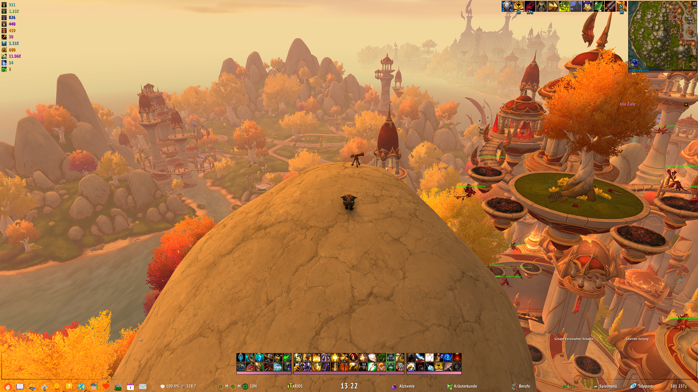
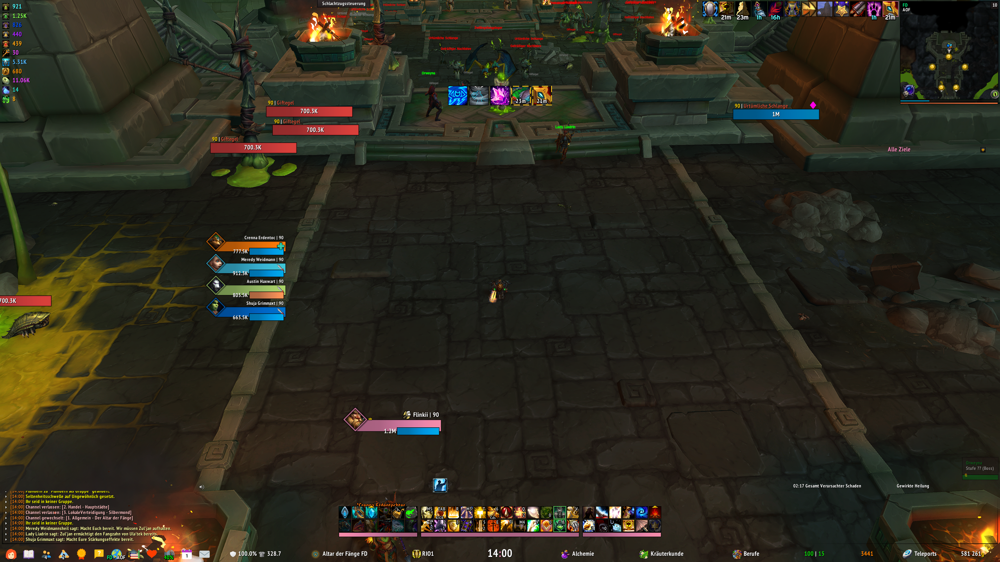
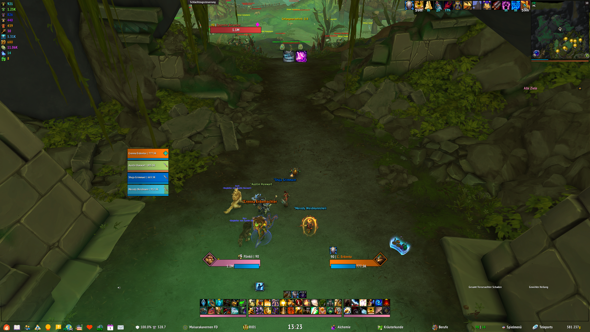
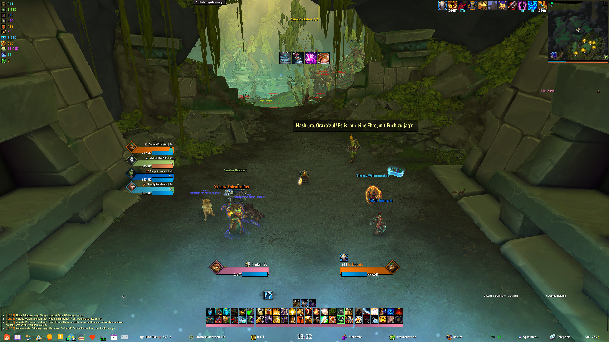
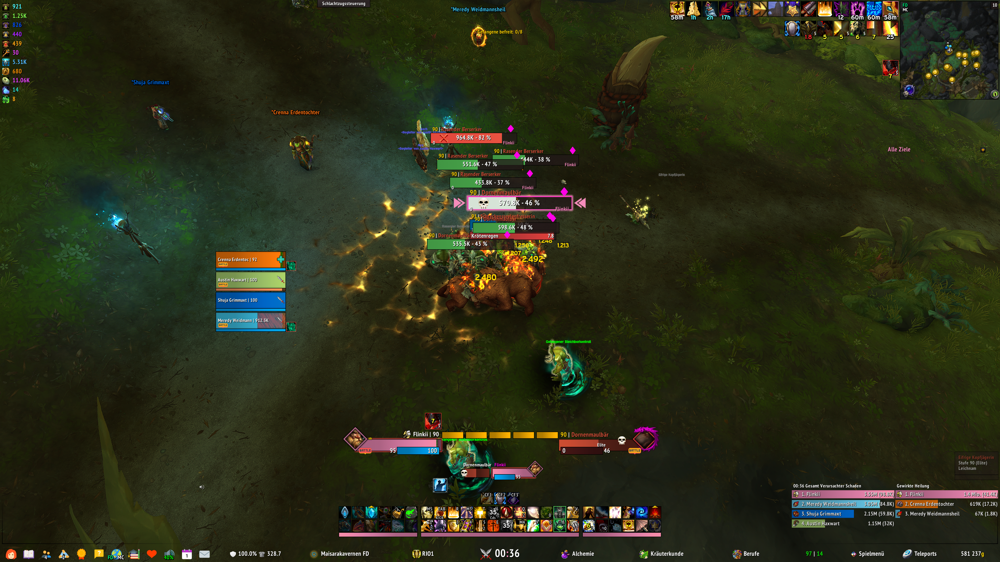
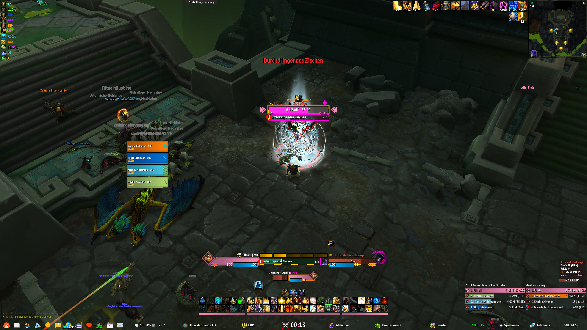
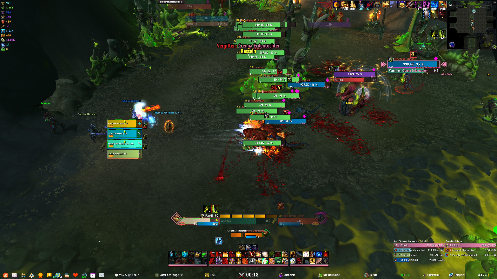
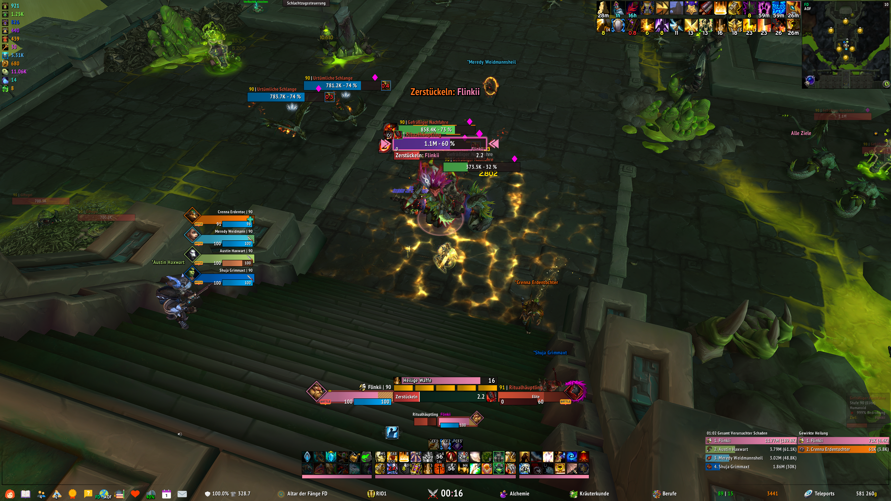
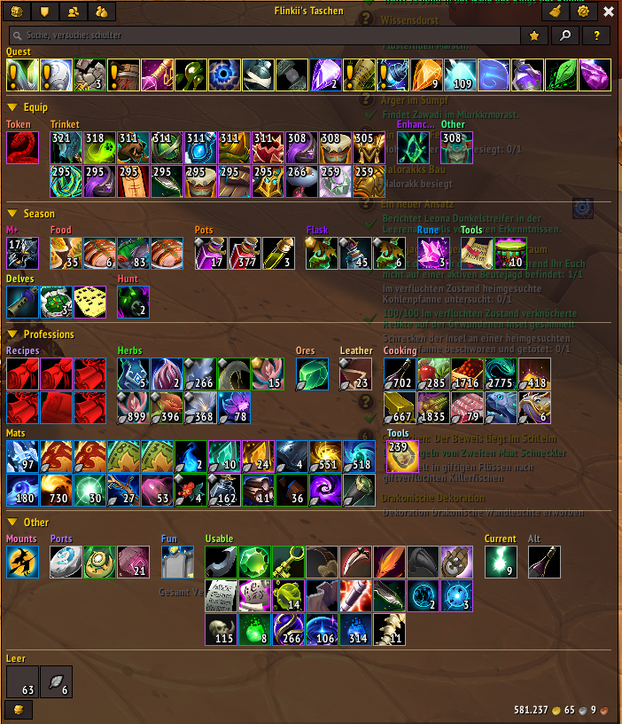

  

# MaUI v8.5 [Tank/DD/Heal] [1440p]

Here I have put together my complete ElvUI profile for you. MaUI is built for 1440p, other resolutions are scaled by the installer so the layout keeps its proportions.

The easiest way to get it is the [**MaUI Installer**](https://www.curseforge.com/wow/addons/maui) on CurseForge, it sets up the whole interface in one go. All profile strings are still here for a manual import.

## Features
- Layouts for tanks/damage dealers and healers, each with an optional Cooldown Manager variant.
- Self-created dock bar with useful functions.
- Profession menu.
- Health text of group units switches between max life and percentage display in combat.
- Rare/Elite/Boss enemies are highlighted (color of text changes).
- Faction icon and PVP text is displayed when a teammate is PVP marked.
- Quest log is skinned.
- Display of the most important currencies, on top left.
- M+ color highlighting of important units.
- Cooldown Manager styling by mMediaTag.
- Custom combat and role icons.
- Portraits.
- Bag categories for Baganator.
- and much more.

## These addons are required
- 
- 

## These addons are optional
- 
- 
- 

## MaUI Installer

The **MaUI Installer** (`ElvUI_MaUI`, version 1.0.0) is its own addon with its own installation window. It replaces ElvUI's installer and sets up MaUI step by step, you see what happens before anything is changed.

### Installation
1. Install the [MaUI Installer](https://www.curseforge.com/wow/addons/maui) together with ElvUI and mMediaTag (and the optional addons you want).
2. Log in. On a new character the installer opens by itself, otherwise type `/maui` or use the addon compartment.
3. Go through the steps and click **Install**.
4. Reload your interface, done.

### The steps
- **Welcome**: a short system check of ElvUI, mMediaTag and the optional addons.
- **ElvUI setup**: ElvUI's basic game settings (CVars) and the MaUI chat: one window on the left with the tabs General (with trade), Whisper, Group, Guild and Combat Log.
- **Profile**: the MaUI profiles already on your account, e.g. from another character. Pick one to use it right away, or install a new one. For an outdated profile it shows how many settings an update changes and in which areas.
- **Layout**: Tank/DD or Heal, with or without Cooldown Manager.
- **Data panels**: the bar at the bottom (full, center only, dock only or none), the currency panel and the decorative bars.
- **Addons**: which addon profiles to install, for Baganator the full profile or only the categories.
- **Scale**: the UI scale for your resolution (0.5333 at 1440p), with a notice on other resolutions.
- **Install**: a summary, every step shows live whether it worked.

The installer window hides when you enter combat and comes back on the same step afterwards.

### What it sets up
- The ElvUI profile, private and global settings.
- mMediaTag data panel skins and the Cooldown Manager setup.
- The UI scale.
- The Blizzard Edit Mode layout (Retail and Forever).
- The profiles for Details!, Baganator and MaUI M+ Timer, if those addons are installed.

### Advanced mode
Turn on the advanced mode on the layout page to install single parts of ElvUI instead, for example only the nameplates, the unit frames or the action bars. They are copied into your current ElvUI profile together with their frame positions, everything else in your profile stays as it is.

### Alts and updates
- On a new character the installer finds the MaUI profiles of your account and suggests the one you used last. The game settings and chat are set up first.
- When a new version brings changes for your profile, you get a notice at login. It lists the changed areas and how many settings change in each, **Update** applies it right there.
- An update only carries over what MaUI changed, your own changes stay.
- Profiles imported by hand from the v8 or v8.5 strings can be updated too; older profiles can still be used but not updated.
- The update is also available under `ElvUI > MaUI` in the options, together with your profile's version and status.

### Game versions
The installer runs on Retail, Forever, Mists, TBC and Classic. MaUI is built on Retail, on the other versions the installer adapts it:
- Datatexts that a version does not have are replaced (e.g. the M+ score becomes the mMediaTag game menu), dock buttons it does not have are left out without gaps.
- Baganator gets its categories without the expansion and season conditions; the Old, M+, Current, Delves and Hunt categories are left out.
- The Cooldown Manager layouts are available on Retail and Forever, the Edit Mode layout on Retail and Forever with a layout for each.

### Commands
- `/maui` or `/mauiinstall` opens the installer.

If you skip the installer on a new character, ElvUI's own installer opens as usual. The installer's source is in the [Installer Folder](https://github.com/mBlinkii/MaUI-ElvUI-Profile-Strings/tree/main/Installer).

## Manual import
1. Import one of the ElvUI layouts under `ElvUI > Profile > Import`:
   - [`elvui_profile_tank-dd.txt`](https://github.com/mBlinkii/MaUI-ElvUI-Profile-Strings/blob/main/Profile/elvui_profile_tank-dd.txt) or [`elvui_profile_tank-dd-cdm.txt`](https://github.com/mBlinkii/MaUI-ElvUI-Profile-Strings/blob/main/Profile/elvui_profile_tank-dd-cdm.txt) (with Cooldown Manager)
   - [`elvui_profile_heal.txt`](https://github.com/mBlinkii/MaUI-ElvUI-Profile-Strings/blob/main/Profile/elvui_profile_heal.txt) or [`elvui_profile_heal-cdm.txt`](https://github.com/mBlinkii/MaUI-ElvUI-Profile-Strings/blob/main/Profile/elvui_profile_heal-cdm.txt) (with Cooldown Manager)
2. Import [`elvui_private.txt`](https://github.com/mBlinkii/MaUI-ElvUI-Profile-Strings/blob/main/Profile/elvui_private.txt) and [`elvui_globale.txt`](https://github.com/mBlinkii/MaUI-ElvUI-Profile-Strings/blob/main/Profile/elvui_globale.txt) the same way, click on Import and Reload.
3. Import [`mmt_datapanels.txt`](https://github.com/mBlinkii/MaUI-ElvUI-Profile-Strings/blob/main/Profile/mmt_datapanels.txt) under `ElvUI > mMediaTag > Cosmetic > DTPanels`, scroll down and paste the string into the text field, click on import.
4. For a Cooldown Manager layout import [`mmt_cdm.txt`](https://github.com/mBlinkii/MaUI-ElvUI-Profile-Strings/blob/main/Profile/mmt_cdm.txt) under `ElvUI > mMediaTag > Cooldown Manager`.
5. Import [`blizzard.txt`](https://github.com/mBlinkii/MaUI-ElvUI-Profile-Strings/blob/main/Profile/blizzard.txt) (Retail) or [`blizzard_forever.txt`](https://github.com/mBlinkii/MaUI-ElvUI-Profile-Strings/blob/main/Profile/blizzard_forever.txt) (Forever) into the Blizzard Edit Mode.
6. (Optional) Import the profiles of the addons you use:
   - Baganator (Retail): [`baganator_profile.txt`](https://github.com/mBlinkii/MaUI-ElvUI-Profile-Strings/blob/main/Profile/baganator_profile.txt) or only the categories [`baganator_category.txt`](https://github.com/mBlinkii/MaUI-ElvUI-Profile-Strings/blob/main/Profile/baganator_category.txt)
   - Baganator (Forever): [`baganator_profile_forever.txt`](https://github.com/mBlinkii/MaUI-ElvUI-Profile-Strings/blob/main/Profile/baganator_profile_forever.txt) or only the categories [`baganator_category_forever.txt`](https://github.com/mBlinkii/MaUI-ElvUI-Profile-Strings/blob/main/Profile/baganator_category_forever.txt)
   - Details!: [`details.txt`](https://github.com/mBlinkii/MaUI-ElvUI-Profile-Strings/blob/main/Profile/details.txt)
   - MaUI M+ Timer: [`maui_mplus_timer.txt`](https://github.com/mBlinkii/MaUI-ElvUI-Profile-Strings/blob/main/Profile/maui_mplus_timer.txt)
7. Check your UI Scale and set it to 0.53333... the UI is built for a resolution of 2560 x 1440. Otherwise you need to set up frames and panels by hand.

## Profile string files
- [Profile Folder](https://github.com/mBlinkii/MaUI-ElvUI-Profile-Strings/tree/main/Profile)

## Archive
Older profile versions (v3 - v8.5) and legacy addons can be found here:
- [Archive Folder](https://github.com/mBlinkii/MaUI-ElvUI-Profile-Strings/tree/main/Archive)

## Discord

## Screenshots

**Open world, out of combat:** only the dock, the info panels and the action bars stay on screen.

**Group out of combat:** party frames, player and target with portraits.

**Group frames in the compact view.**

**In a dungeon:** the party frames next to the player, cast bars and the Details! meters at the bottom right.

**Combat:** nameplates with highlighted targets and casts.

**Important casts** of the target are shown big in the middle.

**Big pulls:** the M+ color highlighting of important enemies.

**Elite fight** with the class resource and the buffs above the player.

**Bags:** the MaUI categories for Baganator.

